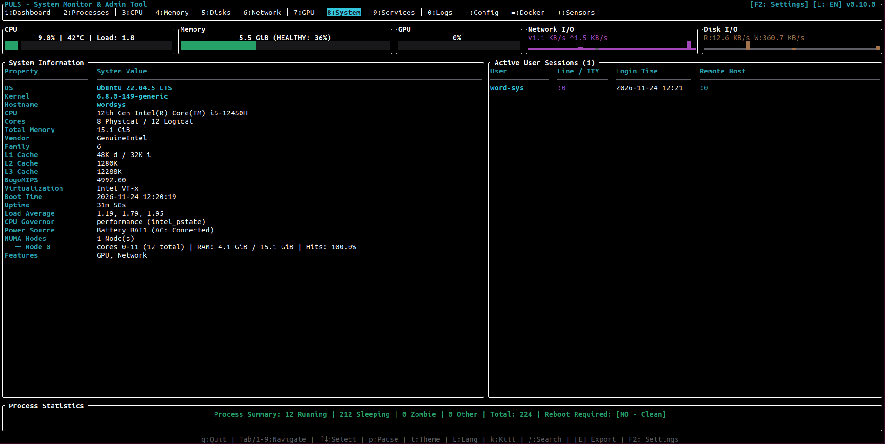

**Sprachen:** [English](README.md) | [Türkçe](README.tr.md) | [Français](README.fr.md) | [Deutsch](README.de.md) | [Español](README.es.md) | [Italiano](README.it.md) | [Русский](README.ru.md)

<p align="left">
  
</p>

# PULS

**Ein abhängigkeitsfreies, vereintes Systemüberwachungs- und Verwaltungswerkzeug für Linux**

PULS kombiniert präzise Kernel-Telemetrie mit nativer Linux-Systemadministration in einer einzigen statischen Binary (~1,6 MB) mit **null externen Rust-Crates** (`0` Einträge in `[dependencies]`). Überwachen Sie Hardware-Sensoren, Linux-PSI-Druckwerte, ZRAM- und Block-I/O-Latenzen, verwalten Sie System- und Rootless-User-Systemd-Dienste, inspizieren Sie strukturierte Journal-Logs, setzen Sie CPU-Affinität und I/O-Priorität, bearbeiten Sie GRUB / `systemd-boot` / Live-Kernel-`sysctl`-Parameter transaktional, steuern Sie Docker & Podman und zeichnen Sie Telemetrie-Sessions auf oder spielen Sie diese offline ab.

## Screenshots

| **Dashboard & Systemübersicht** | **Hierarchischer Prozessbaum** |
| :---: | :---: |
| <a href="https://raw.githubusercontent.com/word-sys/puls/refs/heads/main/screenshots/screenshot0.png"></a> | <a href="https://raw.githubusercontent.com/word-sys/puls/refs/heads/main/screenshots/screenshot1.png"></a> |
| **CPU- & NUMA-Architektur** | **Speicher- & Swap-Belegung** |
| <a href="https://raw.githubusercontent.com/word-sys/puls/refs/heads/main/screenshots/screenshot2.png"></a> | <a href="https://raw.githubusercontent.com/word-sys/puls/refs/heads/main/screenshots/screenshot3.png"></a> |
| **Speicher, Inodes & Mount-Optionen** | **Netzwerkschnittstellen & Aktive Sockets** |
| <a href="https://raw.githubusercontent.com/word-sys/puls/refs/heads/main/screenshots/screenshot4.png"></a> | <a href="https://raw.githubusercontent.com/word-sys/puls/refs/heads/main/screenshots/screenshot5.png"></a> |
| **Multi-GPU-Überwachung (NVIDIA & Intel)** | **Systeminfo, Sitzungen & Diagnose** |
| <a href="https://raw.githubusercontent.com/word-sys/puls/refs/heads/main/screenshots/screenshot6.png"></a> | <a href="https://raw.githubusercontent.com/word-sys/puls/refs/heads/main/screenshots/screenshot7.png"></a> |
| **Systemd-Dienste & Timer** | **System-Journal-Logs & Boot-Verlauf** |
| <a href="https://raw.githubusercontent.com/word-sys/puls/refs/heads/main/screenshots/screenshot8.png"></a> | <a href="https://raw.githubusercontent.com/word-sys/puls/refs/heads/main/screenshots/screenshot9.png"></a> |
| **GRUB, systemd-boot & sysctl Konfiguration** | **Hardware-Sensoren, Stromversorgung & Lüfter** |
| <a href="https://raw.githubusercontent.com/word-sys/puls/refs/heads/main/screenshots/screenshot10.png"></a> | <a href="https://raw.githubusercontent.com/word-sys/puls/refs/heads/main/screenshots/screenshot11.png"></a> |

---

## Architektur & Designprinzipien

PULS v0.10.0 basiert vollständig auf der Rust-Standardbibliothek und direkten Linux-Kernel-Schnittstellen mit **null externen Crate-Abhängigkeiten**:

*   **Null Abhängigkeiten (`[dependencies]` in `Cargo.toml` leer)**: `ratatui`, `crossterm`, `sysinfo`, `bollard`, `tokio`, `futures-util`, `log` und `env_logger` vollständig ersetzt (`Cargo.lock` von 230 Paketen auf 1 reduziert).
*   **Eigene Linux-Terminal-Engine (`src/term/`)**: Direktes `termios`-Raw-Mode, `ioctl(TIOCGWINSZ)` + `SIGWINCH`, `poll(2)`, UTF-8-Tastatur- & SGR-1006-Mausparser, synchronisiertes Double-Buffered-Diff-Rendering auf tiefschwarzem Server-Canvas sowie 2×4-Unicode-Braille-Diagramme.
*   **Direkte Kernel- & Hardware-Telemetrie (`src/sys/`)**: Native `/proc`- und `/sys`-Parser, binärer SMBIOS-Typ-17-DMI-Decoder, binäre `utmp`/logind-Sitzungsanalyse, dynamisches NVML (`dlopen("libnvidia-ml.so.1")`), `/proc/[pid]/fdinfo` DRM-VRAM-Zuordnung und direkte Syscalls (`kill`, `setpriority`, `sethostname`, `sched_setaffinity`, `ioprio_set`).
*   **Nativer Container-Client**: Eigener HTTP/1.1- & JSON-Client über Unix-Domain-Sockets mit Cgroup-v2-Fast-Path für Docker und Rootless-Podman.
*   **Transaktionaler Boot- & `sysctl`-Editor**: Bearbeiten Sie GRUB, `systemd-boot`, `/etc/kernel/cmdline` und Live-`sysctl`-Parameter (`/proc/sys` -> `/etc/sysctl.d/99-puls.conf`) mit Diff-Vorschau (`u`) vor dem atomaren Speichern.

---

## Funktionen

### 1. Ressourcen- & Hardware-Überwachung
*   **CPU, NUMA & PSI**: Pro-Kern-Balken, adaptive Layouts (128+ Kerne), L1/L2/L3-Cache, Skalierungs-Governors, NUMA-Topologie und Linux-CPU-PSI (`/proc/pressure/cpu`).
*   **Speicher, ZRAM & PSI**: Nebeneinanderliegende RAM- & Swap-Anzeigen, Live-Braille-Verlaufsdiagramm, visuelle Speicherzusammensetzung, ZRAM-Kompression, SMBIOS-DIMM-Details und Memory-PSI.
*   **Speicher, Latenz & Inodes**: Multi-Panel-Storage-Dashboard, Volume-Kapazitätskarten, `/proc/diskstats` `await_ms`/`busy_pct`, I/O-Scheduler, NVMe/SMART-Temperaturen, I/O-PSI und Inodes (`statvfs`).
*   **Netzwerk & Socket-Inspektor**: Bandbreite, Link-Speed/MTU, WLAN-Signal (`/proc/net/wireless`), `TxQ/RxQ`-Warteschlangen, TCP-Retransmits, Live-`/`-Filter und `Enter`-Sprung zur Prozess-PID.
*   **NVIDIA-, AMD- & Intel-GPUs**: Auslastung, VRAM, Taktraten, Temperaturen, Lüfter-RPM, PCIe-Generation/Breite, Leistungslimits, Throttling und Pro-PID-VRAM.
*   **Stromversorgung & Sensoren**: Akkugesundheit, Leistung (Watt), Spannung, Ladezyklen, Netzteilstatus und gruppierte hwmon-Sensoren.

### 2. Prozesse, Dienste, Logs & Snapshots
*   **Prozesse & Container**: Baumansicht (`t`), `Unit / Cgroup`-Spalte, POSIX-Signale (`k`/`F9`), Renice (`[`/`]`), CPU-Affinität (`a`), I/O-Priorität (`i`), Prozess-Inspektor mit PSS/FD/Threads (`Enter`), Docker/Podman-Steuerung (`s`/`x`/`r`/`p`/`l`).
*   **Systemd-Dienste & Logs**: System- vs. `--user`-Umschaltung (`u`), Unit-Datei-Ansicht (`v`), Timer & `Boot Blame` (`Links`/`Rechts`), 4-spaltiger strukturierter JSON-Journal-Viewer (`EMERG..DEBUG`).
*   **Snapshots & Flight Recorder**: Headless-JSON/Markdown-Export (`--snapshot [PFAD]` oder `E`), JSONL-Aufzeichnung (`--record`) und Offline-Wiedergabe (`--replay` mit `<`/`>`).
*   **7 Sprachen & 6 Themes**: Persistente Einstellungen (`F2`/`Shift+S` -> `~/.config/puls/config.ini`) und vollständige Mausunterstützung.

---

## Tastenkürzel

| Taste | Aktion |
| :--- | :--- |
| `q` / `Esc` | PULS beenden (oder aktives Modal schließen) |
| `Tab` / `1`..`9`, `0`, `-`, `=`, `+` | Tabs wechseln (`1`: Dashboard, `2`: Prozesse, `3`: CPU, `4`: Speicher, `5`: Datenträger, `6`: Netzwerk, `7`: GPU, `8`: System, `9`: Dienste, `0`: Logs, `-`: Konfig, `=`: Container, `+`: Sensoren) |
| `F2` / `Shift+S` / `s` | Einstellungen öffnen / schließen |
| `E` | Sofortigen JSON-Snapshot exportieren (`puls_snapshot_<zeit>.json`) |
| `<` / `>` | Im `--replay`-Modus spulen (oder Boot-Sitzung in Logs wechseln) |
| `L` / `t` / `p` | Sprache / Theme wechseln / Pausieren |
| Prozesse `t` / `k` / `a` / `i` / `[` `]` / `Enter` | Baum / Signale / CPU-Affinität / I/O-Priorität / Renice / Inspektor |
| Netzwerk `/` / `Enter` | Sockets filtern / Zugehörige PID inspizieren |
| Dienste `u` / `v` / `g` / `Left` `Right` | `--user`-Modus / Unit-Datei / Logs / Untertabs (Dienste, Timer, Boot Blame) |
| Konfig `Left` `Right` / `Enter` / `u` | Bootloader vs. `sysctl` / Bearbeiten / Transaktionalen Diff prüfen & anwenden |

---

## Installation

### Statische Binary (Portabel)
```bash
# Für x86_64 (AMD64)
wget https://github.com/word-sys/puls/releases/latest/download/puls-0.10.0-x86_64-linux-musl.tar.gz
tar -xzf puls-0.10.0-x86_64-linux-musl.tar.gz
sudo mv puls /usr/local/bin/puls

# Für aarch64 (ARM64)
wget https://github.com/word-sys/puls/releases/latest/download/puls-0.10.0-aarch64-linux-musl.tar.gz
tar -xzf puls-0.10.0-aarch64-linux-musl.tar.gz
sudo mv puls /usr/local/bin/puls
```

### Debian / Ubuntu Paket (.deb)
```bash
# AMD64
wget https://github.com/word-sys/puls/releases/latest/download/puls_0.10.0_amd64.deb
sudo apt install ./puls_0.10.0_amd64.deb

# ARM64
wget https://github.com/word-sys/puls/releases/latest/download/puls_0.10.0_arm64.deb
sudo apt install ./puls_0.10.0_arm64.deb
```

### Aus dem Quellcode kompilieren
```bash
cargo build --release --target x86_64-unknown-linux-musl
```

---

## Verwendung

| Befehl | Modus |
| :--- | :--- |
| `puls` | **Standardmodus**: Vollständige Überwachung von System, Prozessen, Containern und Benutzer-Diensten. |
| `sudo puls` | **Administratormodus**: Uneingeschränkter Zugriff auf Systemd, Journal-Logs, Bootloader und `sysctl`. |
| `puls --safe` | **Sicherheitsmodus**: Nur Lesezugriff, deaktiviert alle schreibenden Aktionen. |
| `puls --snapshot [PFAD]` | **Headless-Snapshot**: Gibt einen vollständigen JSON-Snapshot auf stdout aus (oder schreibt `.json`/`.md` nach `PFAD`). |
| `puls --record <DATEI.jsonl>` | **Flight Recorder**: Zeichnet Telemetrie-Frames live in eine JSONL-Datei auf. |
| `puls --replay <DATEI.jsonl>` | **Offline-Wiedergabe**: Öffnet eine JSONL-Aufzeichnung offline mit `<`/`>`-Navigation. |
| `puls --telemetry` | **Telemetriemodus**: Gibt Startzeit-Diagnosen beim Programmstart aus. |

---

## Lizenz

PULS steht unter der [GNU General Public License v3.0](LICENSE).
