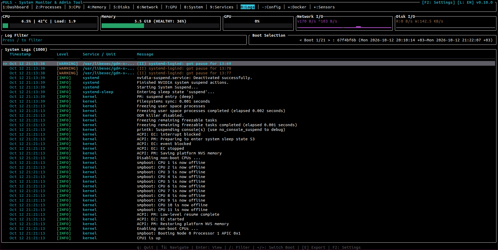

**Idiomas:** [English](README.md) | [Türkçe](README.tr.md) | [Français](README.fr.md) | [Deutsch](README.de.md) | [Español](README.es.md) | [Italiano](README.it.md) | [Русский](README.ru.md)

<p align="left">
  
</p>

# PULS

**Una herramienta unificada de monitoreo y administración del sistema sin dependencias para Linux**

PULS combina telemetría del kernel de alta fidelidad con administración nativa de Linux en un único binario estático (~1,6 MB) con **cero crates externos de Rust** (`0` entradas en `[dependencies]`). Monitoree hardware, presión Linux PSI, ZRAM y latencia de discos, administre servicios systemd del sistema y de usuario (`--user`), inspeccione registros journald estructurados, ajuste afinidad de CPU y prioridad de E/S, edite GRUB / `systemd-boot` / `sysctl` en vivo de forma transaccional, controle Docker y Podman, y grabe/reproduzca sesiones de telemetría desde una interfaz TUI de alto contraste.

## Capturas de pantalla

| **Panel y Resumen del sistema** | **Árbol jerárquico de procesos** |
| :---: | :---: |
| <a href="https://raw.githubusercontent.com/word-sys/puls/refs/heads/main/screenshots/screenshot0.png"></a> | <a href="https://raw.githubusercontent.com/word-sys/puls/refs/heads/main/screenshots/screenshot1.png"></a> |
| **Arquitectura CPU y NUMA** | **Asignación de Memoria y Swap** |
| <a href="https://raw.githubusercontent.com/word-sys/puls/refs/heads/main/screenshots/screenshot2.png"></a> | <a href="https://raw.githubusercontent.com/word-sys/puls/refs/heads/main/screenshots/screenshot3.png"></a> |
| **Almacenamiento, Inodos y Opciones de montaje** | **Interfaces de red y Sockets activos** |
| <a href="https://raw.githubusercontent.com/word-sys/puls/refs/heads/main/screenshots/screenshot4.png"></a> | <a href="https://raw.githubusercontent.com/word-sys/puls/refs/heads/main/screenshots/screenshot5.png"></a> |
| **Monitoreo Multi-GPU (NVIDIA e Intel)** | **Info del sistema, Sesiones y Diagnósticos** |
| <a href="https://raw.githubusercontent.com/word-sys/puls/refs/heads/main/screenshots/screenshot6.png"></a> | <a href="https://raw.githubusercontent.com/word-sys/puls/refs/heads/main/screenshots/screenshot7.png"></a> |
| **Servicios Systemd y Temporizadores** | **Registros del sistema e Historial de arranque** |
| <a href="https://raw.githubusercontent.com/word-sys/puls/refs/heads/main/screenshots/screenshot8.png"></a> | <a href="https://raw.githubusercontent.com/word-sys/puls/refs/heads/main/screenshots/screenshot9.png"></a> |
| **Configuración GRUB, systemd-boot y sysctl** | **Sensores de hardware, Energía y Ventiladores** |
| <a href="https://raw.githubusercontent.com/word-sys/puls/refs/heads/main/screenshots/screenshot10.png"></a> | <a href="https://raw.githubusercontent.com/word-sys/puls/refs/heads/main/screenshots/screenshot11.png"></a> |

---

## Arquitectura y Principios de Diseño

PULS v0.10.0 está construido íntegramente sobre la biblioteca estándar de Rust e interfaces directas del kernel Linux con **cero dependencias externas**:

*   **Cero Dependencias (`[dependencies]` vacío en `Cargo.toml`)**: Reemplazo total de `ratatui`, `crossterm`, `sysinfo`, `bollard`, `tokio`, `futures-util`, `log` y `env_logger` (`Cargo.lock` reducido de 230 paquetes a 1).
*   **Motor Terminal Linux Nativo (`src/term/`)**: Modo raw `termios`, redimensionamiento `ioctl(TIOCGWINSZ)` + `SIGWINCH`, `poll(2)`, teclado UTF-8 + ratón SGR 1006, renderizador diferencial de doble búfer sincronizado sobre lienzo negro de servidor y gráficos Braille 2×4.
*   **Telemetría Directa del Kernel (`src/sys/`)**: Analizadores `/proc` y `/sys`, decodificación binaria SMBIOS Tipo 17 DMI, sesiones `utmp`/logind, NVML dinámico (`dlopen("libnvidia-ml.so.1")`), VRAM DRM por PID y llamadas al sistema directas (`kill`, `setpriority`, `sethostname`, `sched_setaffinity`, `ioprio_set`).
*   **Cliente Nativo de Contenedores**: Cliente HTTP/1.1 + JSON sobre sockets Unix con lectura rápida Cgroup v2 para Docker y Podman sin root.
*   **Editor Transaccional de Arranque y `sysctl`**: Edite GRUB, `systemd-boot`, `/etc/kernel/cmdline` y parámetros `sysctl` en memoria (`/proc/sys` -> `/etc/sysctl.d/99-puls.conf`) con vista de diferencias (`u`) antes de guardar atómicamente.

---

## Características

### 1. Monitoreo de Recursos y Hardware
*   **CPU, NUMA y PSI**: Barras por núcleo, cuadrículas adaptativas (128+ núcleos), caché L1/L2/L3, gobernadores de frecuencia, topología NUMA y Linux PSI (`/proc/pressure/cpu`).
*   **Memoria, ZRAM y PSI**: Medidores de RAM y Swap en paralelo, gráfico Braille en vivo, desglose visual (Activo, Caché, Disponible, Swap), compresión ZRAM, detalles DIMM SMBIOS y PSI de memoria.
*   **Almacenamiento, Latencia e Inodos**: Panel multipanel con tarjetas de capacidad, tasas de E/S, `await_ms`/`busy_pct`, planificador de E/S, temperaturas NVMe/SMART, PSI de E/S e inodos (`statvfs`).
*   **Red e Inspector de Sockets**: Ancho de banda, velocidad/MTU, señal Wi-Fi (`/proc/net/wireless`), colas `TxQ/RxQ`, retransmisiones TCP, filtro `/` y salto directo al PID (`Enter`).
*   **GPUs NVIDIA, AMD e Intel**: Utilización, VRAM, relojes, temperaturas, RPM de ventilador, PCIe, límites de energía, throttling y VRAM por PID.
*   **Energía y Sensores**: Salud de batería, vatios, voltaje, ciclos, estado de CA y sensores hwmon agrupados.

### 2. Procesos, Servicios, Registros y Snapshots
*   **Procesos y Contenedores**: Árbol jerárquico (`t`), columna `Unit / Cgroup`, señales POSIX (`k`/`F9`), renice (`[`/`]`), afinidad de CPU (`a`), prioridad de E/S (`i`), inspector PSS/FD/Hilos (`Enter`), control de Docker/Podman (`s`/`x`/`r`/`p`/`l`).
*   **Servicios Systemd y Registros**: Cambio sistema/`--user` (`u`), visor de archivo de unidad (`v`), temporizadores y `Boot Blame` (`Izquierda`/`Derecha`), visor estructurado de 4 columnas JSON (`EMERG..DEBUG`).
*   **Snapshots y Grabador de Vuelo**: Exportación JSON/Markdown sin interfaz (`--snapshot [RUTA]` o tecla `E`), grabación JSONL (`--record`) y reproducción sin conexión (`--replay` con `<`/`>`).
*   **7 Idiomas y 6 Temas**: Configuración persistente (`F2`/`Shift+S` -> `~/.config/puls/config.ini`) y soporte completo de ratón.

---

## Atajos de Teclado

| Tecla | Acción |
| :--- | :--- |
| `q` / `Esc` | Salir de PULS (o cerrar ventana modal) |
| `Tab` / `1`..`9`, `0`, `-`, `=`, `+` | Cambiar pestaña (`1`: Panel, `2`: Procesos, `3`: CPU, `4`: Memoria, `5`: Discos, `6`: Red, `7`: GPU, `8`: Sistema, `9`: Servicios, `0`: Registros, `-`: Config, `=`: Contenedores, `+`: Sensores) |
| `F2` / `Shift+S` / `s` | Abrir / cerrar Configuración |
| `E` | Exportar instantánea JSON (`puls_snapshot_<fecha>.json`) |
| `<` / `>` | Recorrer línea de tiempo en `--replay` (o cambiar arranque en Registros) |
| `L` / `t` / `p` | Cambiar idioma / tema / pausa |
| Procesos `t` / `k` / `a` / `i` / `[` `]` / `Enter` | Árbol / Señales / Afinidad CPU / Prioridad E/S / Renice / Inspector |
| Red `/` / `Enter` | Filtrar sockets / Inspeccionar PID propietario |
| Servicios `u` / `v` / `g` / `Left` `Right` | Cambio `--user` / Archivo de unidad / Logs / Subpestañas (Servicios, Timers, Boot Blame) |
| Config `Left` `Right` / `Enter` / `u` | Arranque vs `sysctl` / Editar / Revisar y aplicar cambios |

---

## Instalación

### Binario Estático (Portátil)
```bash
# Para x86_64 (AMD64)
wget https://github.com/word-sys/puls/releases/latest/download/puls-0.10.0-x86_64-linux-musl.tar.gz
tar -xzf puls-0.10.0-x86_64-linux-musl.tar.gz
sudo mv puls /usr/local/bin/puls

# Para aarch64 (ARM64)
wget https://github.com/word-sys/puls/releases/latest/download/puls-0.10.0-aarch64-linux-musl.tar.gz
tar -xzf puls-0.10.0-aarch64-linux-musl.tar.gz
sudo mv puls /usr/local/bin/puls
```

### Paquete Debian / Ubuntu (.deb)
```bash
# AMD64
wget https://github.com/word-sys/puls/releases/latest/download/puls_0.10.0_amd64.deb
sudo apt install ./puls_0.10.0_amd64.deb

# ARM64
wget https://github.com/word-sys/puls/releases/latest/download/puls_0.10.0_arm64.deb
sudo apt install ./puls_0.10.0_arm64.deb
```

### Compilar desde el Código Fuente
```bash
cargo build --release --target x86_64-unknown-linux-musl
```

---

## Uso

| Comando | Modo |
| :--- | :--- |
| `puls` | **Modo Estándar**: Monitoreo completo del sistema, procesos, contenedores y servicios de usuario. |
| `sudo puls` | **Modo Administrador**: Control total de systemd, registros, arranque y `sysctl`. |
| `puls --safe` | **Modo Seguro**: Solo lectura, desactiva todas las acciones de escritura. |
| `puls --snapshot [RUTA]` | **Instantánea sin TTY**: Imprime un diagnóstico JSON por stdout (o guarda `.json`/`.md` en `RUTA`). |
| `puls --record <ARCHIVO.jsonl>` | **Grabador de vuelo**: Guarda telemetría en tiempo real en formato JSONL. |
| `puls --replay <ARCHIVO.jsonl>` | **Reproducción offline**: Abre un registro JSONL con navegación `<`/`>`. |
| `puls --telemetry` | **Modo Telemetría**: Muestra tiempos de inicialización al arrancar. |

---

## Licencia

PULS está licenciado bajo [GNU General Public License v3.0](LICENSE).
