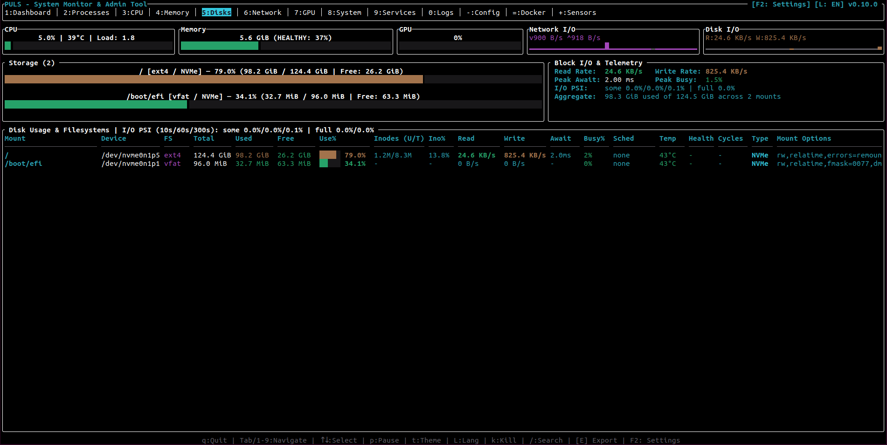
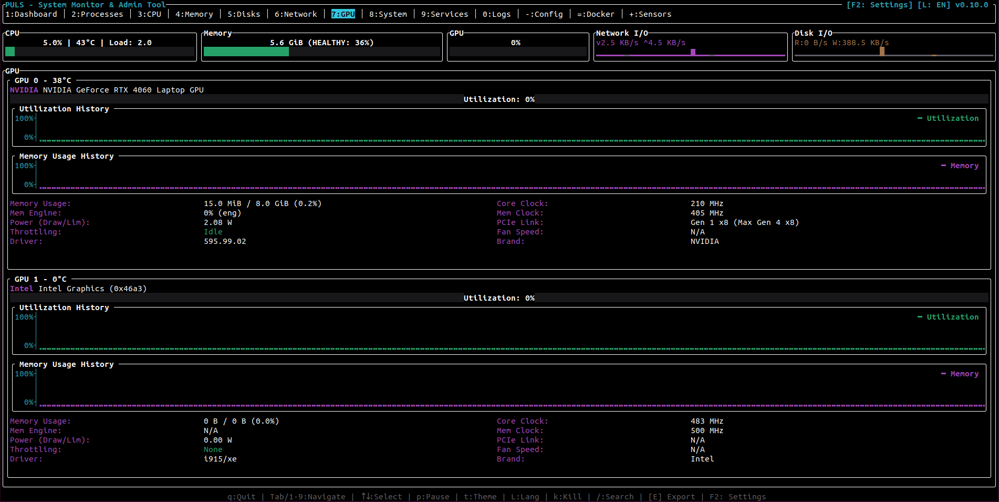

**Langues :** [English](README.md) | [Türkçe](README.tr.md) | [Français](README.fr.md) | [Deutsch](README.de.md) | [Español](README.es.md) | [Italiano](README.it.md) | [Русский](README.ru.md)

<p align="left">
  
</p>

# PULS

**Un outil unifié de surveillance et d'administration système sans dépendance pour Linux**

PULS combine télémétrie noyau haute précision et administration Linux native dans un seul binaire statique (~1,6 Mo) avec **zéro crate Rust externe** (`0` entrée dans `[dependencies]`). Surveillez le matériel, les pressions Linux PSI, ZRAM et la latence disque, gérez les services systemd système et utilisateur (`--user`), inspectez les journaux structurés, configurez l'affinité CPU et la priorité E/S, éditez GRUB / `systemd-boot` / `sysctl` en direct de manière transactionnelle, contrôlez Docker & Podman, et enregistrez/rejouez des sessions de télémétrie depuis une interface TUI haute visibilité.

## Captures d'écran

| **Tableau de bord et Aperçu système** | **Arborescence des processus** |
| :---: | :---: |
| <a href="https://raw.githubusercontent.com/word-sys/puls/refs/heads/main/screenshots/screenshot0.png"></a> | <a href="https://raw.githubusercontent.com/word-sys/puls/refs/heads/main/screenshots/screenshot1.png"></a> |
| **Architecture CPU et NUMA** | **Allocation Mémoire et Swap** |
| <a href="https://raw.githubusercontent.com/word-sys/puls/refs/heads/main/screenshots/screenshot2.png"></a> | <a href="https://raw.githubusercontent.com/word-sys/puls/refs/heads/main/screenshots/screenshot3.png"></a> |
| **Stockage, Inodes et Options de montage** | **Interfaces réseau et Sockets actifs** |
| <a href="https://raw.githubusercontent.com/word-sys/puls/refs/heads/main/screenshots/screenshot4.png"></a> | <a href="https://raw.githubusercontent.com/word-sys/puls/refs/heads/main/screenshots/screenshot5.png"></a> |
| **Surveillance Multi-GPU (NVIDIA et Intel)** | **Infos système, Sessions et Diagnostics** |
| <a href="https://raw.githubusercontent.com/word-sys/puls/refs/heads/main/screenshots/screenshot6.png"></a> | <a href="https://raw.githubusercontent.com/word-sys/puls/refs/heads/main/screenshots/screenshot7.png"></a> |
| **Services Systemd et Minuteries** | **Journaux système et Historique de démarrage** |
| <a href="https://raw.githubusercontent.com/word-sys/puls/refs/heads/main/screenshots/screenshot8.png"></a> | <a href="https://raw.githubusercontent.com/word-sys/puls/refs/heads/main/screenshots/screenshot9.png"></a> |
| **Configuration GRUB, systemd-boot et sysctl** | **Capteurs matériels, Alimentation et Ventilateurs** |
| <a href="https://raw.githubusercontent.com/word-sys/puls/refs/heads/main/screenshots/screenshot10.png"></a> | <a href="https://raw.githubusercontent.com/word-sys/puls/refs/heads/main/screenshots/screenshot11.png"></a> |

---

## Architecture et Principes de Conception

PULS v0.10.0 repose exclusivement sur la bibliothèque standard Rust et les interfaces natives du noyau Linux avec **zéro dépendance externe** :

*   **Zéro Dépendance (`[dependencies]` vide dans `Cargo.toml`)** : Remplacement complet de `ratatui`, `crossterm`, `sysinfo`, `bollard`, `tokio`, `futures-util`, `log` et `env_logger` (`Cargo.lock` réduit de 230 paquets à 1).
*   **Moteur Terminal Linux Natif (`src/term/`)** : Mode brut `termios`, redimensionnement `ioctl(TIOCGWINSZ)` + `SIGWINCH`, entrées `poll(2)`, clavier UTF-8 + souris SGR 1006, rendu différentiel double tampon synchronisé (DEC 2026) sur fond noir serveur et graphiques Braille 2×4.
*   **Télémétrie Noyau et Matérielle Directe (`src/sys/`)** : Analyseurs `/proc` et `/sys`, décodage binaire SMBIOS Type 17 DMI, sessions `utmp`/logind, NVML dynamique (`dlopen("libnvidia-ml.so.1")`), VRAM DRM par PID (`/proc/[pid]/fdinfo`) et appels système directs (`kill`, `setpriority`, `sethostname`, `sched_setaffinity`, `ioprio_set`).
*   **Client Conteneurs Natif** : Client HTTP/1.1 + JSON sur sockets Unix avec lecture rapide Cgroup v2 pour Docker et Podman rootless.
*   **Éditeur Transactionnel de Démarrage et `sysctl`** : Édition sécurisée en mémoire de GRUB, `systemd-boot`, `/etc/kernel/cmdline` et `sysctl` (`/proc/sys` -> `/etc/sysctl.d/99-puls.conf`) avec revue des différences (`u`) avant écriture atomique.

---

## Fonctionnalités

### 1. Surveillance Matérielle et Ressources
*   **CPU, NUMA et PSI** : Barres par cœur, grilles adaptatives (128+ cœurs), caches L1/L2/L3, gouverneurs de fréquence, localité NUMA et Linux PSI (`/proc/pressure/cpu`).
*   **Mémoire, ZRAM et PSI** : Jauges RAM & Swap côte à côte, graphique Braille en temps réel, décomposition visuelle (Actif, Cache, Disponible, Swap), compression ZRAM, détails SMBIOS DIMM et PSI mémoire.
*   **Stockage, Latence et Inodes** : Tableau de bord multi-panneaux, cartes de capacité, débits E/S, `await_ms`/`busy_pct`, ordonnanceur E/S, températures NVMe/SMART, PSI E/S et inodes (`statvfs`).
*   **Réseau et Inspecteur de Sockets** : Débits d'interface, vitesse/MTU, signal Wi-Fi (`/proc/net/wireless`), files `TxQ/RxQ`, retransmissions TCP, filtrage `/` et saut direct vers le PID (`Enter`).
*   **GPU NVIDIA, AMD et Intel** : Utilisation, VRAM, fréquences, températures, ventilateurs RPM, PCIe, limites de puissance, throttling et attribution VRAM par PID.
*   **Alimentation et Capteurs** : Santé de la batterie, puissance en watts, cycles, état secteur et capteurs hwmon groupés.

### 2. Processus, Services, Journaux et Snapshots
*   **Processus & Conteneurs** : Arbre hiérarchique (`t`), colonne `Unit / Cgroup`, signaux POSIX (`k`/`F9`), renice (`[`/`]`), affinité CPU (`a`), priorité E/S (`i`), inspecteur détaillé PSS/FD/Threads (`Enter`), contrôle Docker/Podman (`s`/`x`/`r`/`p`/`l`).
*   **Services Systemd & Journaux** : Bascule système/`--user` (`u`), visualiseur de fichier d'unité (`v`), minuteries et `Boot Blame` (`Gauche`/`Droite`), journaux structurés JSON 4 colonnes avec priorités exactes `EMERG..DEBUG`.
*   **Snapshots & Enregistreur de Vol** : Export instantané JSON/Markdown (`--snapshot [CHEMIN]` ou touche `E`), enregistrement JSONL (`--record`) et lecture hors ligne (`--replay` avec `<`/`>`).
*   **7 Langues et 6 Thèmes** : Paramètres persistants (`F2`/`Shift+S` -> `~/.config/puls/config.ini`) et support souris complet.

---

## Raccourcis Clavier

| Touche | Action |
| :--- | :--- |
| `q` / `Esc` | Quitter PULS (ou fermer la fenêtre modale) |
| `Tab` / `1`..`9`, `0`, `-`, `=`, `+` | Changer d'onglet (`1`: Accueil, `2`: Processus, `3`: CPU, `4`: Mémoire, `5`: Disques, `6`: Réseau, `7`: GPU, `8`: Système, `9`: Services, `0`: Journaux, `-`: Config, `=`: Conteneurs, `+`: Capteurs) |
| `F2` / `Shift+S` / `s` | Ouvrir / fermer les Paramètres |
| `E` | Exporter un snapshot JSON (`puls_snapshot_<date>.json`) |
| `<` / `>` | Naviguer dans `--replay` (ou changer de démarrage dans Journaux) |
| `L` / `t` / `p` | Changer de langue / thème / pause |
| Processus `t` / `k` / `a` / `i` / `[` `]` / `Enter` | Arbre / Signaux / Affinité CPU / Priorité E/S / Renice / Inspecteur |
| Réseau `/` / `Enter` | Filtrer les sockets / Inspecter le PID propriétaire |
| Services `u` / `v` / `g` / `Left` `Right` | Bascule `--user` / Fichier d'unité / Logs / Sous-onglets (Services, Timers, Boot Blame) |
| Config `Left` `Right` / `Enter` / `u` | Démarrage vs `sysctl` / Éditer / Valider le diff transactionnel |

---

## Installation

### Binaire Statique (Portable)
```bash
# Pour x86_64 (AMD64)
wget https://github.com/word-sys/puls/releases/latest/download/puls-0.10.0-x86_64-linux-musl.tar.gz
tar -xzf puls-0.10.0-x86_64-linux-musl.tar.gz
sudo mv puls /usr/local/bin/puls

# Pour aarch64 (ARM64)
wget https://github.com/word-sys/puls/releases/latest/download/puls-0.10.0-aarch64-linux-musl.tar.gz
tar -xzf puls-0.10.0-aarch64-linux-musl.tar.gz
sudo mv puls /usr/local/bin/puls
```

### Paquet Debian / Ubuntu (.deb)
```bash
# AMD64
wget https://github.com/word-sys/puls/releases/latest/download/puls_0.10.0_amd64.deb
sudo apt install ./puls_0.10.0_amd64.deb

# ARM64
wget https://github.com/word-sys/puls/releases/latest/download/puls_0.10.0_arm64.deb
sudo apt install ./puls_0.10.0_arm64.deb
```

### Compilation depuis les Sources
```bash
cargo build --release --target x86_64-unknown-linux-musl
```

---

## Utilisation

| Commande | Mode |
| :--- | :--- |
| `puls` | **Mode Standard** : Surveillance complète du système, processus, conteneurs et services utilisateur. |
| `sudo puls` | **Mode Administrateur** : Contrôle complet systemd, journaux, démarrage et `sysctl`. |
| `puls --safe` | **Mode Sécurisé** : Lecture seule, désactive toute action de modification. |
| `puls --snapshot [CHEMIN]` | **Snapshot sans interface** : Exporte un diagnostic JSON sur stdout (ou `.json`/`.md` vers `CHEMIN`). |
| `puls --record <FICHIER.jsonl>` | **Enregistreur de vol** : Enregistre la télémétrie en direct au format JSONL. |
| `puls --replay <FICHIER.jsonl>` | **Lecture hors ligne** : Rejoue un enregistrement JSONL avec `<`/`>`. |
| `puls --telemetry` | **Télémétrie** : Affiche les temps d'initialisation au démarrage. |

---

## Licence

PULS est distribué sous licence [GNU General Public License v3.0](LICENSE).
