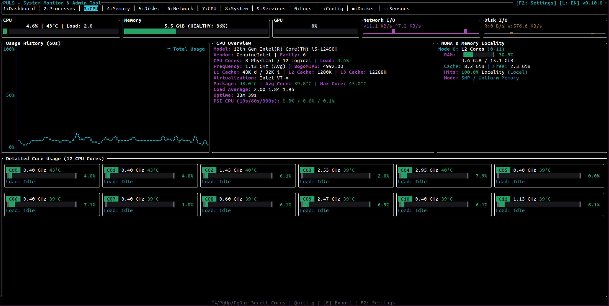

**Lingue:** [English](README.md) | [Türkçe](README.tr.md) | [Français](README.fr.md) | [Deutsch](README.de.md) | [Español](README.es.md) | [Italiano](README.it.md) | [Русский](README.ru.md)

<p align="left">
  
</p>

# PULS

**Uno strumento unificato di monitoraggio e amministrazione di sistema senza dipendenze per Linux**

PULS combina telemetria del kernel ad alta precisione e amministrazione Linux nativa in un singolo binario statico (~1,6 MB) con **zero crate Rust esterni** (`0` voci in `[dependencies]`). Monitora hardware, pressione Linux PSI, ZRAM e latenza disco, gestisci servizi systemd di sistema e utente (`--user`), ispeziona log journald strutturati, imposta affinità CPU e priorità I/O, modifica GRUB / `systemd-boot` / `sysctl` in tempo reale in modo transazionale, controlla Docker e Podman e registra/riproduci sessioni di telemetria da una TUI ad alto contrasto.

## Screenshot

| **Dashboard e Panoramica di sistema** | **Albero gerarchico dei processi** |
| :---: | :---: |
| <a href="https://raw.githubusercontent.com/word-sys/puls/refs/heads/main/screenshots/screenshot0.png"></a> | <a href="https://raw.githubusercontent.com/word-sys/puls/refs/heads/main/screenshots/screenshot1.png"></a> |
| **Architettura CPU e NUMA** | **Allocazione Memoria e Swap** |
| <a href="https://raw.githubusercontent.com/word-sys/puls/refs/heads/main/screenshots/screenshot2.png"></a> | <a href="https://raw.githubusercontent.com/word-sys/puls/refs/heads/main/screenshots/screenshot3.png"></a> |
| **Archiviazione, Inode e Opzioni di mount** | **Interfacce di rete e Socket attivi** |
| <a href="https://raw.githubusercontent.com/word-sys/puls/refs/heads/main/screenshots/screenshot4.png"></a> | <a href="https://raw.githubusercontent.com/word-sys/puls/refs/heads/main/screenshots/screenshot5.png"></a> |
| **Monitoraggio Multi-GPU (NVIDIA e Intel)** | **Info di sistema, Sessioni e Diagnostica** |
| <a href="https://raw.githubusercontent.com/word-sys/puls/refs/heads/main/screenshots/screenshot6.png"></a> | <a href="https://raw.githubusercontent.com/word-sys/puls/refs/heads/main/screenshots/screenshot7.png"></a> |
| **Servizi Systemd e Timer** | **Log di sistema e Cronologia avvii** |
| <a href="https://raw.githubusercontent.com/word-sys/puls/refs/heads/main/screenshots/screenshot8.png"></a> | <a href="https://raw.githubusercontent.com/word-sys/puls/refs/heads/main/screenshots/screenshot9.png"></a> |
| **Configurazione GRUB, systemd-boot e sysctl** | **Sensori hardware, Alimentazione e Ventole** |
| <a href="https://raw.githubusercontent.com/word-sys/puls/refs/heads/main/screenshots/screenshot10.png"></a> | <a href="https://raw.githubusercontent.com/word-sys/puls/refs/heads/main/screenshots/screenshot11.png"></a> |

---

## Architettura e Principi di Progettazione

PULS v0.10.0 è basato interamente sulla libreria standard Rust e sulle interfacce dirette del kernel Linux con **zero dipendenze esterne**:

*   **Zero Dipendenze (`[dependencies]` vuoto in `Cargo.toml`)**: Sostituiti completamente `ratatui`, `crossterm`, `sysinfo`, `bollard`, `tokio`, `futures-util`, `log` ed `env_logger` (`Cargo.lock` ridotto da 230 pacchetti a 1).
*   **Motore Terminale Linux Nativo (`src/term/`)**: Modalità raw `termios`, ridimensionamento `ioctl(TIOCGWINSZ)` + `SIGWINCH`, `poll(2)`, tastiera UTF-8 + mouse SGR 1006, renderer differenziale a doppio buffer sincronizzato su sfondo nero server e grafici Braille 2×4.
*   **Telemetria Kernel Diretta (`src/sys/`)**: Parser `/proc` e `/sys`, decodifica binaria SMBIOS Tipo 17 DMI, sessioni `utmp`/logind, NVML dinamico (`dlopen("libnvidia-ml.so.1")`), VRAM DRM per PID e chiamate di sistema dirette (`kill`, `setpriority`, `sethostname`, `sched_setaffinity`, `ioprio_set`).
*   **Client Container Nativo**: Client HTTP/1.1 + JSON su socket Unix con percorso rapido Cgroup v2 per Docker e Podman rootless.
*   **Editor Transazionale di Avvio e `sysctl`**: Modifica GRUB, `systemd-boot`, `/etc/kernel/cmdline` e parametri `sysctl` in memoria (`/proc/sys` -> `/etc/sysctl.d/99-puls.conf`) con anteprima diff (`u`) prima del salvataggio atomico.

---

## Funzionalità

### 1. Monitoraggio Risorse e Hardware
*   **CPU, NUMA e PSI**: Barre per core, griglie adattive (128+ core), cache L1/L2/L3, governor di frequenza, topologia NUMA e Linux PSI (`/proc/pressure/cpu`).
*   **Memoria, ZRAM e PSI**: Indicatori RAM e Swap affiancati, grafico Braille live, ripartizione visiva (Attiva, Cache, Disponibile, Swap), compressione ZRAM, dettagli DIMM SMBIOS e PSI memoria.
*   **Archiviazione, Latenza e Inode**: Dashboard multipannello con schede volume, velocità I/O, `await_ms`/`busy_pct`, scheduler I/O, temperature NVMe/SMART, PSI I/O e inode (`statvfs`).
*   **Rete e Ispettore Socket**: Banda interfaccia, velocità/MTU, segnale Wi-Fi (`/proc/net/wireless`), code `TxQ/RxQ`, ritrasmissioni TCP, filtro `/` e salto diretto al PID (`Enter`).
*   **GPU NVIDIA, AMD e Intel**: Utilizzo, VRAM, clock, temperature, RPM ventola, PCIe, limiti di potenza, throttling e VRAM per PID.
*   **Alimentazione e Sensori**: Salute batteria, watt, voltaggio, cicli, stato AC e sensori hwmon raggruppati.

### 2. Processi, Servizi, Log e Snapshot
*   **Processi e Container**: Albero gerarchico (`t`), colonna `Unit / Cgroup`, segnali POSIX (`k`/`F9`), renice (`[`/`]`), affinità CPU (`a`), priorità I/O (`i`), ispettore PSS/FD/Thread (`Enter`), controllo Docker/Podman (`s`/`x`/`r`/`p`/`l`).
*   **Servizi Systemd e Log**: Passaggio sistema/`--user` (`u`), visualizzatore unit file (`v`), timer e `Boot Blame` (`Sinistra`/`Destra`), log strutturati JSON a 4 colonne (`EMERG..DEBUG`).
*   **Snapshot e Flight Recorder**: Esportazione JSON/Markdown headless (`--snapshot [PERCORSO]` o tasto `E`), registrazione JSONL (`--record`) e riproduzione offline (`--replay` con `<`/`>`).
*   **7 Lingue e 6 Temi**: Impostazioni persistenti (`F2`/`Shift+S` -> `~/.config/puls/config.ini`) e supporto completo del mouse.

---

## Scorciatoie da Tastiera

| Tasto | Azione |
| :--- | :--- |
| `q` / `Esc` | Esci da PULS (o chiudi la finestra modale) |
| `Tab` / `1`..`9`, `0`, `-`, `=`, `+` | Cambia scheda (`1`: Dashboard, `2`: Processi, `3`: CPU, `4`: Memoria, `5`: Dischi, `6`: Rete, `7`: GPU, `8`: Sistema, `9`: Servizi, `0`: Log, `-`: Config, `=`: Container, `+`: Sensori) |
| `F2` / `Shift+S` / `s` | Apri / chiudi Impostazioni |
| `E` | Esporta snapshot JSON istantaneo (`puls_snapshot_<data>.json`) |
| `<` / `>` | Naviga nella timeline `--replay` (o cambia avvio nei Log) |
| `L` / `t` / `p` | Cambia lingua / tema / pausa |
| Processi `t` / `k` / `a` / `i` / `[` `]` / `Enter` | Albero / Segnali / Affinità CPU / Priorità I/O / Renice / Ispettore |
| Rete `/` / `Enter` | Filtra socket / Ispeziona PID proprietario |
| Servizi `u` / `v` / `g` / `Left` `Right` | Modalità `--user` / Unit file / Log / Sottoschede (Servizi, Timer, Boot Blame) |
| Config `Left` `Right` / `Enter` / `u` | Bootloader vs `sysctl` / Modifica / Revisiona e applica diff |

---

## Installazione

### Binario Statico (Portatile)
```bash
# Per x86_64 (AMD64)
wget https://github.com/word-sys/puls/releases/latest/download/puls-0.10.0-x86_64-linux-musl.tar.gz
tar -xzf puls-0.10.0-x86_64-linux-musl.tar.gz
sudo mv puls /usr/local/bin/puls

# Per aarch64 (ARM64)
wget https://github.com/word-sys/puls/releases/latest/download/puls-0.10.0-aarch64-linux-musl.tar.gz
tar -xzf puls-0.10.0-aarch64-linux-musl.tar.gz
sudo mv puls /usr/local/bin/puls
```

### Pacchetto Debian / Ubuntu (.deb)
```bash
# AMD64
wget https://github.com/word-sys/puls/releases/latest/download/puls_0.10.0_amd64.deb
sudo apt install ./puls_0.10.0_amd64.deb

# ARM64
wget https://github.com/word-sys/puls/releases/latest/download/puls_0.10.0_arm64.deb
sudo apt install ./puls_0.10.0_arm64.deb
```

### Compilazione dai Sorgenti
```bash
cargo build --release --target x86_64-unknown-linux-musl
```

---

## Utilizzo

| Comando | Modalità |
| :--- | :--- |
| `puls` | **Modalità Standard**: Monitoraggio completo di sistema, processi, container e servizi utente. |
| `sudo puls` | **Modalità Amministratore**: Controllo completo di systemd, log, bootloader e `sysctl`. |
| `puls --safe` | **Modalità Sicura**: Sola lettura, disattiva ogni azione di modifica. |
| `puls --snapshot [PERCORSO]` | **Snapshot Headless**: Stampa diagnostica JSON su stdout (o salva `.json`/`.md` in `PERCORSO`). |
| `puls --record <FILE.jsonl>` | **Flight Recorder**: Registra i frame di telemetria live in formato JSONL. |
| `puls --replay <FILE.jsonl>` | **Riproduzione Offline**: Apre una registrazione JSONL offline con `<`/`>`. |
| `puls --telemetry` | **Modalità Telemetria**: Mostra i tempi di avvio durante l'inizializzazione. |

---

## Licenza

PULS è rilasciato sotto licenza [GNU General Public License v3.0](LICENSE).
