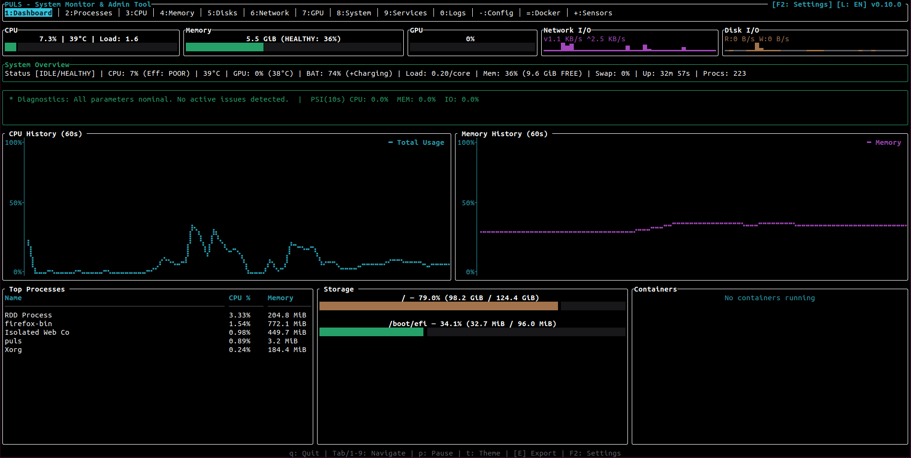
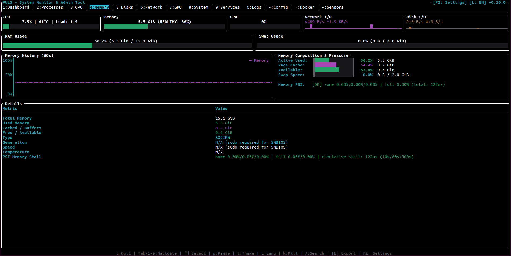
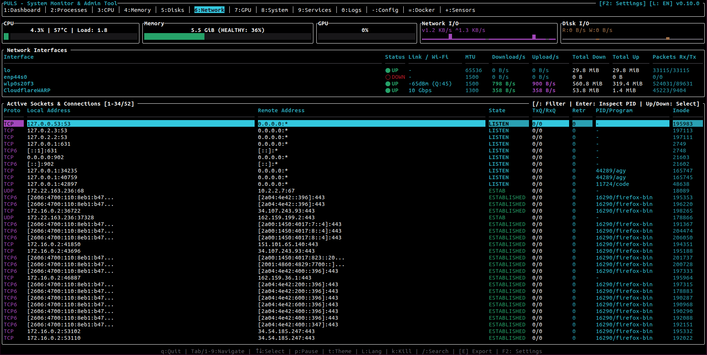
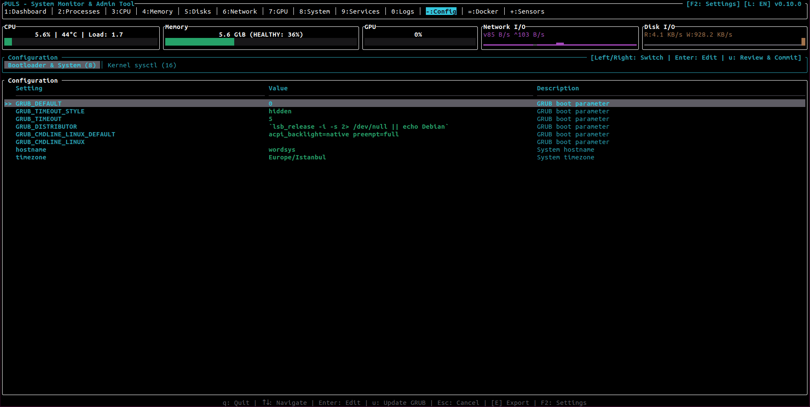

**Languages:** [English](README.md) | [Türkçe](README.tr.md) | [Français](README.fr.md) | [Deutsch](README.de.md) | [Español](README.es.md) | [Italiano](README.it.md) | [Русский](README.ru.md)

<p align="left">
  
</p>

# PULS

**A zero-dependency unified system monitoring and management tool for Linux**

PULS combines high-fidelity kernel telemetry with native Linux system administration in a single, ~1.6 MB static binary with **zero external Rust crates** (`0` entries in `[dependencies]`). Monitor hardware telemetry, Linux PSI pressure stalls, ZRAM & block I/O latency, manage system and rootless user systemd services, inspect structured journal logs, analyze hierarchical process trees, configure CPU affinity & I/O priority, edit GRUB / `systemd-boot` / live kernel `sysctl` parameters safely, monitor Docker & Podman containers, and record/replay telemetry sessions directly from a custom high-contrast Terminal User Interface (TUI).

## Screenshots

| **Dashboard & System Overview** | **Hierarchical Process Tree** |
| :---: | :---: |
| <a href="https://raw.githubusercontent.com/word-sys/puls/refs/heads/main/screenshots/screenshot0.png"></a> | <a href="https://raw.githubusercontent.com/word-sys/puls/refs/heads/main/screenshots/screenshot1.png"></a> |
| **CPU & NUMA Architecture** | **Memory & Swap Allocation** |
| <a href="https://raw.githubusercontent.com/word-sys/puls/refs/heads/main/screenshots/screenshot2.png"></a> | <a href="https://raw.githubusercontent.com/word-sys/puls/refs/heads/main/screenshots/screenshot3.png"></a> |
| **Storage, Inodes & Mount Options** | **Network Interfaces & Active Sockets** |
| <a href="https://raw.githubusercontent.com/word-sys/puls/refs/heads/main/screenshots/screenshot4.png"></a> | <a href="https://raw.githubusercontent.com/word-sys/puls/refs/heads/main/screenshots/screenshot5.png"></a> |
| **Multi-GPU Monitoring (NVIDIA & Intel)** | **System Info, Sessions & Diagnostics** |
| <a href="https://raw.githubusercontent.com/word-sys/puls/refs/heads/main/screenshots/screenshot6.png"></a> | <a href="https://raw.githubusercontent.com/word-sys/puls/refs/heads/main/screenshots/screenshot7.png"></a> |
| **Systemd Services & Timers** | **System Journal Logs & Boot History** |
| <a href="https://raw.githubusercontent.com/word-sys/puls/refs/heads/main/screenshots/screenshot8.png"></a> | <a href="https://raw.githubusercontent.com/word-sys/puls/refs/heads/main/screenshots/screenshot9.png"></a> |
| **GRUB, systemd-boot & sysctl Config** | **Hardware Sensors, Power & Fans** |
| <a href="https://raw.githubusercontent.com/word-sys/puls/refs/heads/main/screenshots/screenshot10.png"></a> | <a href="https://raw.githubusercontent.com/word-sys/puls/refs/heads/main/screenshots/screenshot11.png"></a> |

---

## Architecture & Design Principles

PULS v0.10.0 is built entirely on the Rust standard library and direct Linux kernel interfaces with **zero external crate dependencies**:

*   **Zero Dependencies (`Cargo.toml` `[dependencies]` is empty)**: Replaced `ratatui`, `crossterm`, `sysinfo`, `bollard`, `tokio`, `futures-util`, `log`, and `env_logger` with purpose-built native Linux subsystems (`Cargo.lock` reduced from 230 packages to 1).
*   **Custom Linux Terminal Engine (`src/term/`)**: Direct `termios` raw mode, `ioctl(TIOCGWINSZ)` + `SIGWINCH` resize handling, `poll(2)` non-blocking input, UTF-8 keyboard + SGR 1006 mouse parsing, DEC Synchronized Output double-buffered cell diff rendering on a full-black server canvas, and native widgets including 2×4 Unicode Braille line charts.
*   **Direct Kernel & Hardware Telemetry (`src/sys/`)**: Single-pass `/proc` and `/sys` parsers, binary SMBIOS DSP0134 Type 17 DMI memory decoding, binary `utmp`/logind session parsing, runtime `dlopen("libnvidia-ml.so.1")` NVML (with clean static `musl` fallback), `/proc/[pid]/fdinfo` DRM VRAM attribution for AMD/Intel GPUs, and direct POSIX/Linux syscalls (`kill`, `setpriority`, `sethostname`, `sched_setaffinity`, `ioprio_set`).
*   **Native Container Client**: Custom synchronous HTTP/1.1 + recursive JSON + Docker multiplexed log client over Unix domain sockets with Cgroup v2 fast-path telemetry for Docker and rootless Podman.
*   **Transactional Config & Boot Editor**: Edit GRUB, `systemd-boot` (`/boot/efi/loader/loader.conf`), `/etc/kernel/cmdline`, and live kernel `sysctl` parameters in memory. Review a colorized diff modal (`u`) before committing atomically to disk.
*   **Resilient Terminal Control**: Protected with a panic hook that cleanly disables raw mode, mouse capture, and alternate screen upon termination.

---

## Features

### 1. Resource & Hardware Monitoring
*   **CPU, NUMA & PSI**: Real-time per-core utilization bars, adaptive high-core grid layouts (128+ cores), L1/L2/L3 cache statistics, frequency scaling governors, NUMA node locality, and Linux CPU Pressure Stall Information (`/proc/pressure/cpu`).
*   **Memory, ZRAM & PSI**: Side-by-side RAM & Swap gauges, live Braille memory history chart, visual composition breakdown (Active, Page Cache, Available, Swap), ZRAM compression telemetry (`/sys/block/zram*/mm_stat`), SMBIOS Type 17 DIMM details, and Memory PSI stalls.
*   **Storage, Latency & Inodes**: Multi-panel storage dashboard with visual volume capacity cards, block I/O throughput, `/proc/diskstats` `await_ms` and `busy_pct`, active I/O scheduler, SMART/NVMe temperatures, mount flags, I/O PSI, and inode allocation (`statvfs`).
*   **Network & Socket Inspector**: Interface bandwidth, link speed/MTU, `/proc/net/wireless` Wi-Fi dBm/quality, and an active TCP/UDP/IPv6 socket table showing `TxQ/RxQ` queues, TCP retransmits, owning PIDs, live `/` filtering, and `Enter` jump-to-Process Inspector.
*   **NVIDIA, AMD & Intel GPUs**: Multi-GPU monitoring via dynamic NVML and native DRM/hwmon showing utilization, VRAM, clocks, temperatures, fan RPM, PCIe link gen/width, power limits, throttling flags, and per-PID VRAM attribution.
*   **Power, Battery & Sensors**: Battery health, wattage, voltage, cycle counts, AC connectivity, and grouped hwmon temperature, fan, voltage, power, and current sensors.

### 2. Process & Container Management
*   **Hierarchical Process Tree & Cgroups**: Toggle between flat sortable list and parent-child tree view (`t`) with systemd unit / container cgroup attribution (`Unit / Cgroup`).
*   **Signals, Renice, CPU Affinity & I/O Priority**: Send POSIX signals (`k`/`F9`), dynamically renice (`[`/`]`), pin CPU cores interactively via bitmask modal (`a`, `sched_setaffinity`), and adjust I/O scheduling class/priority (`i`, `ioprio_set`).
*   **Deep-Dive Process Inspector**: Press `Enter` on any process to inspect `/proc/[pid]/smaps_rollup` PSS/Shared/Private Dirty/Swap memory accounting, open FDs & sockets, per-thread CPU utilization, and environment variables.
*   **Docker & Podman Containers**: Auto-discovers Docker and rootless Podman sockets (`$DOCKER_HOST`, `/run/user/$UID/podman/podman.sock`, `/var/run/docker.sock`). Start (`s`), Stop (`x`), Restart (`r`), Pause (`p`), and stream container logs (`Enter`/`l`).

### 3. Service Management & Structured Logs
*   **System & Rootless User Units (`u`)**: Toggle between `systemctl` (system) and `systemctl --user` (rootless user services) with Start (`s`), Stop (`x`), Restart (`r`), Enable (`e`), Disable (`d`), unit file viewer (`v`), and live service logs (`g`).
*   **Scheduled Timers & Boot Blame**: Switch subtabs (`Left`/`Right`) to inspect `systemd` timers and `Boot Blame` startup impact bars (`systemd-analyze blame`).
*   **Structured Journald Logs**: 4-column journal viewer (`Timestamp`, accurate JSON `PRIORITY` badge `EMERG..DEBUG`, `Service / Unit`, `Message`) with live `/` filtering and `<`/`>` boot session switching.

### 4. Multi-Bootloader, Live `sysctl` & Diagnostics
*   **Bootloader & Kernel `sysctl` Editor (Tab 10)**: Switch subtabs (`Left`/`Right`) between GRUB / `systemd-boot` / `/etc/kernel/cmdline` and curated live `/proc/sys` kernel tunables (persisted atomically to `/etc/sysctl.d/99-puls.conf` via the `u` transactional diff modal).
*   **Telemetry Snapshot Export & Flight Recorder**: Capture headless JSON or Markdown diagnostics (`--snapshot [PATH]` or `E` in-UI) and record/replay historical JSONL telemetry streams (`--record` / `--replay` with `<`/`>` scrubbing).
*   **7 Languages & 6 Themes**: English, Türkçe, Français, Deutsch, Español, Italiano, and Русский (`L`/`l`), persistent Settings modal (`F2`/`Shift+S` -> `~/.config/puls/config.ini`), 6 themes (`t`), and full SGR mouse support.

---

## Keybindings & Controls

### Global Navigation
| Key | Action |
| :--- | :--- |
| `q` / `Esc` | Quit PULS (or close open modal dialog) |
| `Tab` / `1`..`9`, `0`, `-`, `=`, `+` | Switch tabs (`1`: Dashboard, `2`: Processes, `3`: CPU, `4`: Memory, `5`: Disks, `6`: Network, `7`: GPU, `8`: System, `9`: Services, `0`: Logs, `-`: Config, `=`: Containers, `+`: Sensors) |
| `Left Click` / `Scroll Wheel` | Click header tabs or Settings badge, scroll tables and modals |
| `F2` / `Shift+S` / `s` | Open / Close Settings Configuration Modal |
| `E` | Export instant JSON telemetry snapshot (`puls_snapshot_<timestamp>.json`) |
| `<` / `>` | Scrub Flight Recorder timeline in `--replay` mode (or switch boot in Logs tab) |
| `L` / `l` | Cycle interface language (EN -> TR -> FR -> DE -> ES -> IT -> RU) |
| `t` / `T` | Cycle UI color theme (outside Processes tab) |
| `p` | Pause / resume background metric collection |

### Processes Tab (`2`)
| Key | Action |
| :--- | :--- |
| `t` / `F5` | Toggle between Flat List and Hierarchical Process Tree View |
| `k` / `F9` | Open POSIX Signal Selector Modal (`SIGTERM`, `SIGKILL`, `SIGHUP`, `SIGSTOP`, `SIGCONT`, `SIGINT`) |
| `a` | Open Interactive CPU Affinity Mask Modal (`sched_setaffinity`) |
| `i` | Open I/O Scheduling Priority Modal (`ionice` / `ioprio_set`) |
| `[` / `]` | Increase / decrease process scheduling priority (`setpriority`) |
| `Enter` | Open Detailed Process Inspector (Overview & PSS, FDs/Sockets, Threads, Environ) |
| `/` | Filter processes by name |

### Network (`6`), Services (`9`), Config (`-`) & Containers (`=`)
| Tab & Key | Action |
| :--- | :--- |
| Network `/` / `Enter` | Filter active sockets (port/IP/state/process) / Jump to owning PID in Process Inspector |
| Services `Left`/`Right` | Switch between Services, Timers, and Boot Blame subtabs |
| Services `u` / `v` / `g` | Toggle System vs `--user` scope / View unit file / View last 50 journald logs |
| Services `s` / `x` / `r` / `e` / `d` | Start / Stop / Restart / Enable / Disable selected unit |
| Config `Left`/`Right` / `Enter` / `u` | Switch Bootloader vs Kernel `sysctl` / Edit value / Review transactional diff & commit |
| Containers `s` / `x` / `r` / `p` / `l` | Start / Stop / Restart / Pause / Stream live container logs |

---

## Installation

### Static Binary (Portable)
The recommended portable installation uses the statically linked MUSL binary, requiring no runtime dependencies or specific glibc versions. Available for AMD64 (`x86_64`) and ARM64 (`aarch64`):

```bash
# For x86_64 (AMD64)
wget https://github.com/word-sys/puls/releases/latest/download/puls-0.10.0-x86_64-linux-musl.tar.gz
tar -xzf puls-0.10.0-x86_64-linux-musl.tar.gz
sudo mv puls /usr/local/bin/puls

# For aarch64 (ARM64)
wget https://github.com/word-sys/puls/releases/latest/download/puls-0.10.0-aarch64-linux-musl.tar.gz
tar -xzf puls-0.10.0-aarch64-linux-musl.tar.gz
sudo mv puls /usr/local/bin/puls
```

### Debian / Ubuntu Package (.deb)
Install the standalone `.deb` package on Debian, Ubuntu, Linux Mint, or Pop!_OS:

```bash
# Download and install AMD64 package
wget https://github.com/word-sys/puls/releases/latest/download/puls_0.10.0_amd64.deb
sudo apt install ./puls_0.10.0_amd64.deb

# For ARM64 systems
wget https://github.com/word-sys/puls/releases/latest/download/puls_0.10.0_arm64.deb
sudo apt install ./puls_0.10.0_arm64.deb
```

If package dependencies need resolution:
```bash
sudo apt --fix-broken install
```

### Build from Source
Because PULS has **zero external crates**, offline and source builds are instant and require no crate downloads:

1. **Prerequisites**:
   * Rust toolchain (1.75+ recommended): `curl --proto '=https' --tlsv1.2 -sSf https://sh.rustup.rs | sh`
   * Optional musl tools for static builds: `sudo apt install musl-tools` and `rustup target add x86_64-unknown-linux-musl`

2. **Compilation**:
   ```bash
   cargo build --release --target x86_64-unknown-linux-musl
   ```
   The binary is generated at `target/x86_64-unknown-linux-musl/release/puls`.

---

## Usage

PULS adapts its features according to the permissions granted:

| Command | Operating Mode |
| :--- | :--- |
| `puls` | **Standard Mode**: Full monitoring of processes, CPU, memory, disks, network, GPUs, user systemd units, and containers. |
| `sudo puls` | **Administrator Mode**: Unrestricted access to system-wide systemd controls, journal logs, CPU/IO tuning, bootloader, and `sysctl` editing. |
| `puls --safe` | **Safety Mode**: Disables all administrative write actions to prevent accidental changes. |
| `puls --snapshot [PATH]` | **Headless Snapshot**: Prints a full JSON system diagnostic snapshot to stdout (or writes `.json`/`.md` to `PATH`) without requiring a TTY. |
| `puls --record <FILE.jsonl>` | **Flight Recorder**: Streams live telemetry frames to a JSONL file while running the TUI. |
| `puls --replay <FILE.jsonl>` | **Offline Replay**: Opens a recorded JSONL flight log offline in the TUI with `<`/`>` timeline scrubbing. |
| `puls --telemetry` | **Telemetry Mode**: Prints diagnostic startup timing measurements during initialization. |

---

## License

PULS is licensed under the [GNU General Public License v3.0](LICENSE).
