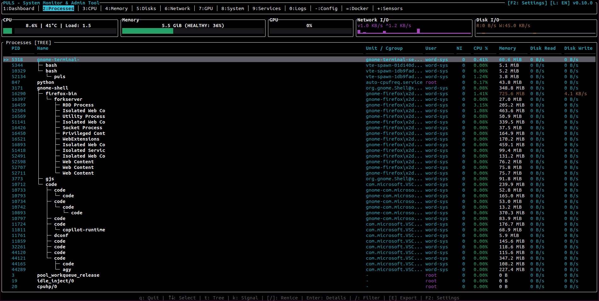
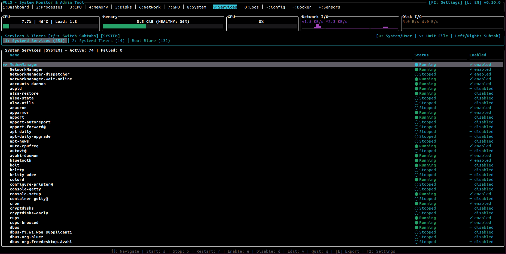
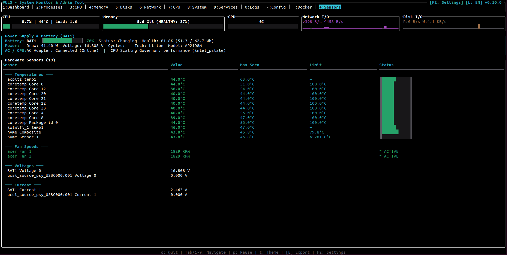

**Языки:** [English](README.md) | [Türkçe](README.tr.md) | [Français](README.fr.md) | [Deutsch](README.de.md) | [Español](README.es.md) | [Italiano](README.it.md) | [Русский](README.ru.md)

<p align="left">
  
</p>

# PULS

**Единый инструмент мониторинга и администрирования Linux без внешних зависимостей**

PULS объединяет высокоточную телеметрию ядра и нативное администрирование Linux в одном статическом бинарном файле (~1,6 МБ) с **нулевым числом внешних крейтов Rust** (`0` записей в `[dependencies]`). Отслеживайте оборудование, показатели давления Linux PSI, сжатие ZRAM и задержки дисков, управляйте системными и пользовательскими (`--user`) службами systemd, просматривайте структурированные журналы journald, настраивайте CPU affinity и приоритет I/O, безопасно редактируйте GRUB / `systemd-boot` / параметры ядра `sysctl`, управляйте контейнерами Docker и Podman, а также записывайте и воспроизводите сеансы телеметрии через собственный контрастный TUI.

## Скриншоты

| **Панель мониторинга и Обзор системы** | **Иерархическое дерево процессов** |
| :---: | :---: |
| <a href="https://raw.githubusercontent.com/word-sys/puls/refs/heads/main/screenshots/screenshot0.png"></a> | <a href="https://raw.githubusercontent.com/word-sys/puls/refs/heads/main/screenshots/screenshot1.png"></a> |
| **Архитектура CPU и NUMA** | **Распределение памяти и Swap** |
| <a href="https://raw.githubusercontent.com/word-sys/puls/refs/heads/main/screenshots/screenshot2.png"></a> | <a href="https://raw.githubusercontent.com/word-sys/puls/refs/heads/main/screenshots/screenshot3.png"></a> |
| **Хранилище, Иноды и Опции монтирования** | **Сетевые интерфейсы и Активные сокеты** |
| <a href="https://raw.githubusercontent.com/word-sys/puls/refs/heads/main/screenshots/screenshot4.png"></a> | <a href="https://raw.githubusercontent.com/word-sys/puls/refs/heads/main/screenshots/screenshot5.png"></a> |
| **Мониторинг Multi-GPU (NVIDIA и Intel)** | **Сведения о системе, Сессии и Диагностика** |
| <a href="https://raw.githubusercontent.com/word-sys/puls/refs/heads/main/screenshots/screenshot6.png"></a> | <a href="https://raw.githubusercontent.com/word-sys/puls/refs/heads/main/screenshots/screenshot7.png"></a> |
| **Службы Systemd и Таймеры** | **Системные журналы и История загрузок** |
| <a href="https://raw.githubusercontent.com/word-sys/puls/refs/heads/main/screenshots/screenshot8.png"></a> | <a href="https://raw.githubusercontent.com/word-sys/puls/refs/heads/main/screenshots/screenshot9.png"></a> |
| **Настройка GRUB, systemd-boot и sysctl** | **Датчики оборудования, Питание и Вентиляторы** |
| <a href="https://raw.githubusercontent.com/word-sys/puls/refs/heads/main/screenshots/screenshot10.png"></a> | <a href="https://raw.githubusercontent.com/word-sys/puls/refs/heads/main/screenshots/screenshot11.png"></a> |

---

## Архитектура и принципы проектирования

PULS v0.10.0 полностью построен на стандартной библиотеке Rust и прямых интерфейсах ядра Linux с **нулевым числом внешних зависимостей**:

*   **Ноль зависимостей (`[dependencies]` в `Cargo.toml` пуст)**: Полностью заменены `ratatui`, `crossterm`, `sysinfo`, `bollard`, `tokio`, `futures-util`, `log` и `env_logger` (`Cargo.lock` сокращён с 230 пакетов до 1).
*   **Собственный терминальный движок Linux (`src/term/`)**: Прямой raw-режим `termios`, изменение размера через `ioctl(TIOCGWINSZ)` + `SIGWINCH`, неблокирующий `poll(2)`, парсер UTF-8 клавиатуры и мыши SGR 1006, синхронизированный двойной буфер на чёрном серверном фоне и графики Брайля 2×4.
*   **Прямая телеметрия ядра и железа (`src/sys/`)**: Парсеры `/proc` и `/sys`, декодер SMBIOS Type 17 DMI, чтение сессий `utmp`/logind, динамический NVML (`dlopen("libnvidia-ml.so.1")`), VRAM по PID через `/proc/[pid]/fdinfo` и прямые системные вызовы (`kill`, `setpriority`, `sethostname`, `sched_setaffinity`, `ioprio_set`).
*   **Нативный клиент контейнеров**: Собственный HTTP/1.1 + JSON клиент через Unix-сокеты с быстрым чтением Cgroup v2 для Docker и rootless Podman.
*   **Транзакционный редактор загрузчика и `sysctl`**: Редактирование GRUB, `systemd-boot`, `/etc/kernel/cmdline` и параметров ядра `sysctl` (`/proc/sys` -> `/etc/sysctl.d/99-puls.conf`) с проверкой diff (`u`) перед атомарной записью.

---

## Возможности

### 1. Мониторинг ресурсов и оборудования
*   **CPU, NUMA и PSI**: Индикаторы загрузки по ядрам, адаптивные сетки (128+ ядер), кэш L1/L2/L3, регуляторы частоты, топология NUMA и Linux PSI (`/proc/pressure/cpu`).
*   **Память, ZRAM и PSI**: Параллельные индикаторы RAM и Swap, график Брайля, визуальная структура памяти (Активная, Кэш, Доступная, Swap), сжатие ZRAM, SMBIOS DIMM и PSI памяти.
*   **Диски, Задержки и Иноды**: Многопанельный обзор дисков, карточки томов, `/proc/diskstats` `await_ms`/`busy_pct`, планировщик I/O, температуры NVMe/SMART, I/O PSI и иноды (`statvfs`).
*   **Сеть и Инспектор сокетов**: Скорость интерфейсов, Link/MTU, сигнал Wi-Fi (`/proc/net/wireless`), очереди `TxQ/RxQ`, ретрансмиты TCP, фильтр `/` и переход к процессу по `Enter`.
*   **GPU NVIDIA, AMD и Intel**: Загрузка, VRAM, частоты, температуры, обороты вентиляторов, PCIe, лимиты мощности, троттлинг и VRAM по PID.
*   **Питание и Датчики**: Состояние батареи, мощность, напряжение, циклы, статус AC и сгруппированные датчики hwmon.

### 2. Процессы, Службы, Журналы и Снимки
*   **Процессы и Контейнеры**: Дерево процессов (`t`), столбец `Unit / Cgroup`, POSIX-сигналы (`k`/`F9`), renice (`[`/`]`), CPU affinity (`a`), приоритет I/O (`i`), инспектор PSS/FD/Потоков (`Enter`), управление Docker/Podman (`s`/`x`/`r`/`p`/`l`).
*   **Службы Systemd и Журналы**: Переключение system/`--user` (`u`), просмотр unit-файла (`v`), таймеры и `Boot Blame` (`Влево`/`Вправо`), 4-колоночный структурированный журнал JSON (`EMERG..DEBUG`).
*   **Снимки и Чёрный ящик (Flight Recorder)**: Автономный экспорт JSON/Markdown (`--snapshot [ПУТЬ]` или клавиша `E`), запись JSONL (`--record`) и офлайн-воспроизведение (`--replay` с `<`/`>`).
*   **7 языков и 6 тем**: Сохраняемые настройки (`F2`/`Shift+S` -> `~/.config/puls/config.ini`) и полная поддержка мыши.

---

## Горячие клавиши

| Клавиша | Действие |
| :--- | :--- |
| `q` / `Esc` | Выход из PULS (или закрытие модального окна) |
| `Tab` / `1`..`9`, `0`, `-`, `=`, `+` | Переключение вкладок (`1`: Обзор, `2`: Процессы, `3`: CPU, `4`: Память, `5`: Диски, `6`: Сеть, `7`: GPU, `8`: Система, `9`: Службы, `0`: Журналы, `-`: Конфиг, `=`: Контейнеры, `+`: Датчики) |
| `F2` / `Shift+S` / `s` | Открыть / закрыть Настройки |
| `E` | Экспортировать JSON-снимок (`puls_snapshot_<дата>.json`) |
| `<` / `>` | Прокрутка шкалы времени в `--replay` (или смена загрузки в Журналах) |
| `L` / `t` / `p` | Смена языка / темы / пауза |
| Процессы `t` / `k` / `a` / `i` / `[` `]` / `Enter` | Дерево / Сигналы / CPU Affinity / Приоритет I/O / Renice / Инспектор |
| Сеть `/` / `Enter` | Фильтр сокетов / Переход к PID процесса |
| Службы `u` / `v` / `g` / `Left` `Right` | Режим `--user` / Unit-файл / Логи / Подвкладки (Службы, Таймеры, Boot Blame) |
| Конфиг `Left` `Right` / `Enter` / `u` | Загрузчик vs `sysctl` / Изменить / Просмотр diff и сохранение |

---

## Установка

### Статический бинарный файл (Портативный)
```bash
# Для x86_64 (AMD64)
wget https://github.com/word-sys/puls/releases/latest/download/puls-0.10.0-x86_64-linux-musl.tar.gz
tar -xzf puls-0.10.0-x86_64-linux-musl.tar.gz
sudo mv puls /usr/local/bin/puls

# Для aarch64 (ARM64)
wget https://github.com/word-sys/puls/releases/latest/download/puls-0.10.0-aarch64-linux-musl.tar.gz
tar -xzf puls-0.10.0-aarch64-linux-musl.tar.gz
sudo mv puls /usr/local/bin/puls
```

### Пакет Debian / Ubuntu (.deb)
```bash
# AMD64
wget https://github.com/word-sys/puls/releases/latest/download/puls_0.10.0_amd64.deb
sudo apt install ./puls_0.10.0_amd64.deb

# ARM64
wget https://github.com/word-sys/puls/releases/latest/download/puls_0.10.0_arm64.deb
sudo apt install ./puls_0.10.0_arm64.deb
```

### Сборка из исходного кода
```bash
cargo build --release --target x86_64-unknown-linux-musl
```

---

## Использование

| Команда | Режим |
| :--- | :--- |
| `puls` | **Стандартный режим**: Полный мониторинг системы, процессов, контейнеров и пользовательских служб. |
| `sudo puls` | **Режим администратора**: Полное управление systemd, журналами, загрузчиком и `sysctl`. |
| `puls --safe` | **Безопасный режим**: Только чтение, отключает любые изменения. |
| `puls --snapshot [ПУТЬ]` | **Автономный снимок**: Выводит JSON-диагностику в stdout (или сохраняет `.json`/`.md` в `ПУТЬ`). |
| `puls --record <ФАЙЛ.jsonl>` | **Запись телеметрии**: Сохраняет кадры телеметрии в JSONL-файл в реальном времени. |
| `puls --replay <ФАЙЛ.jsonl>` | **Офлайн-воспроизведение**: Открывает записанный JSONL-файл с навигацией `<`/`>`. |
| `puls --telemetry` | **Режим телеметрии**: Выводит диагностику времени запуска при инициализации. |

---

## Лицензия

PULS распространяется по лицензии [GNU General Public License v3.0](LICENSE).
